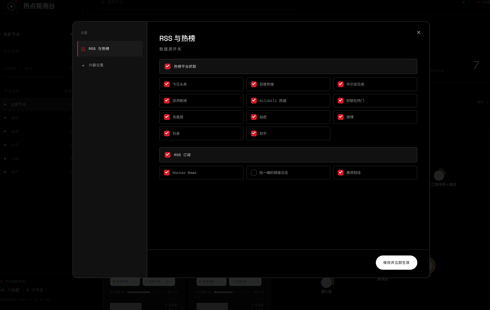
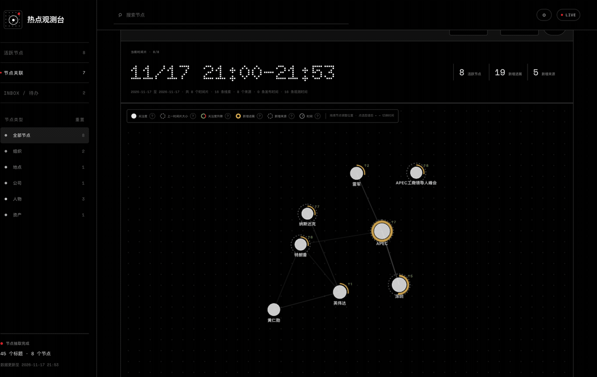

# News Signal Flow

通过关键节点的变化，快速捕捉新闻热点。

News Signal Flow 会采集你感兴趣的话题和新闻，再渲染成节点图。看节点怎么变化，就能理解新闻的热度；看节点之间的关联，就能理解新闻之间的关系。比起一条条翻新闻，这是更快抓住热点重点的方式。

本项目是 [TrendRadar](https://github.com/sansan0/TrendRadar) 的修改版，非官方版本。许可与修改说明见文末「来源与许可」。

## 如何使用

### 1. 按兴趣设置，然后采集

点右上角齿轮，打开「兴趣设置」。写下你关注什么、什么必须抓到、什么不要。也可以直接改 `config/custom/ai/user_interests.txt`：

```text
感兴趣的：
- 开源工具的重大更新，以及开发者实际使用这些工具的案例

必须抓取的：
- 我关注的产品有新版本发布或价格调整

不感兴趣的：
- 广告、招聘和没有新增信息的重复评论
```

保存只写入规则，下一轮采集才按新规则跑。来源在同一处设置的「RSS 与热榜」里开关。




### 2. 在节点关联里看变化

采集完成后打开「节点关联」。每 3 小时一帧，拖动时间轴就能看到热点节点和新闻怎么变。圆圈大小是关注度，黄环是新进展，蓝环是新增来源。点开一个节点，可以看到里面的新闻和进展时间线。


### 3. 收进 Inbox，以后再看

在节点里选一条新闻，点「收进 Inbox」。Inbox 留下标题、摘要、来源和原文链接，分成待办和已完成。下面是点开 APEC，把一条新闻收进去，再打开 Inbox 查看。



## 部署

要单独准备两件事：一个一直在跑的采集服务，一个用来看结果的网页。

Docker Compose 适合服务器，一条命令同时把采集和网页拉起来。macOS / Linux 本机是分开的：采集靠定时任务，网页单独启动。

### Docker Compose

准备一台能访问新闻源的 Linux 服务器，装好 Docker 与 Docker Compose。用域名访问时，把域名指到这台机器，并开放 80、443。Caddy 负责 HTTPS。

```bash
git clone https://github.com/Jimmy-Chung/news-signal-flow.git
cd news-signal-flow
cp docker/.env.full.example docker/.env.full
bash scripts/initialize-user-config.sh
```

编辑 `docker/.env.full`：`TREND_RADAR_DOMAIN`、`TREND_RADAR_ADMIN_TOKEN`（`openssl rand -hex 32`）。`FEISHU_WEBHOOK_URL` 可选。不要提交填好的环境文件。

再编辑 `config/custom/ai/user_interests.txt`，然后启动。容器里的采集默认每 30 分钟跑一次，网页一起起来。频率用 `CRON_SCHEDULE` 改。

```bash
docker compose --env-file docker/.env.full -f docker/docker-compose.full.yml up -d --build
docker compose --env-file docker/.env.full -f docker/docker-compose.full.yml exec trendradar-full /app/scripts/run-trendradar.sh
```

打开 `https://你的域名`。日志和停止：

```bash
docker compose --env-file docker/.env.full -f docker/docker-compose.full.yml logs -f --tail=100 trendradar-full
docker compose --env-file docker/.env.full -f docker/docker-compose.full.yml down
```

### macOS / Linux

需要 Python 3.12+、uv、Node.js 22.13+。在仓库根目录：

```bash
uv sync --locked
bash scripts/initialize-user-config.sh
```

编辑兴趣文件，并在当前终端设置目录：

```bash
export TREND_RADAR_PROJECT_DIR="$PWD"
export TREND_RADAR_CONFIG_DIR="$PWD/config"
export TREND_RADAR_DATA_DIR="$PWD/output"
export TREND_RADAR_DEPLOY_MODE=direct
export TREND_RADAR_ADMIN_TOKEN="$(openssl rand -hex 32)"
```

采集自己跑，网页另外开。本机不会自动定时，把 `bash scripts/run-trendradar.sh` 接到 cron 或系统任务里，采集才会一直进行。关掉网页不会删掉已采集的数据。

```bash
bash scripts/run-trendradar.sh
cd web && npm ci && npm run build && npm run preview:local
```

网页在 [http://localhost:3002](http://localhost:3002)。

### 数据保存在哪

两套环境都用这两个目录：

- `config/`：兴趣和采集配置。
- `output/`：新闻数据库、节点图、Inbox。

备份时带走这两个目录，管理口令另外保存。图谱默认只整理最近 9 天。管理口令、兴趣、数据库和 Inbox 不要提交到仓库。

## 关于数据与来源

热榜通常没有可靠发布时间，系统会回退到首次采集时间，并在详情中标记。因此时间回放展示的是采集范围内可观察到的变化。

热榜数据依赖上游接入的 [newsnow](https://github.com/ourongxing/newsnow) 服务，RSS 来自配置的订阅源。

## 来源与许可

本项目是 [TrendRadar](https://github.com/sansan0/TrendRadar) 的**修改版，非官方版本**。

| | |
| --- | --- |
| 上游项目 | [sansan0/TrendRadar](https://github.com/sansan0/TrendRadar) |
| 基线版本 | v6.10.0 |
| 修改日期 | 2026-11-17 |
| 许可 | GPL-3.0，见 [LICENSE](LICENSE) |

在上游基础上做出的修改：

- 保留上游的热榜/RSS 采集、兴趣筛选、通知与报告能力，内核 `trendradar/`、`mcp_server/` 大部分保持原样；
- 新增 `web/` 节点观测界面（Next.js）：节点列表、节点图谱、三小时时间片回放、Inbox；
- 新增 `web/scripts/export_entity_data.py` 等脚本，把兴趣筛选结果整理成节点快照；
- 新增 `docker/Dockerfile.full`、`docker/entrypoint-full.sh` 与 `scripts/` 下的本地部署脚本；
- 调整运行时路径解析、新增 `config/custom/rss_platforms.yaml` 配置覆盖、把 MCP 默认监听地址改为仅本机；
- 重写本 README，上游原中文说明保留在 [README.upstream.md](README.upstream.md)，其中的界面、部署方式和功能说明以原项目为准。

本项目的修改部分与上游代码一起，整体按 **GPL-3.0** 发布。（GPL-3.0 第 5(a) 条要求分发修改版时显著声明修改并注明日期，本段即为此声明。）
