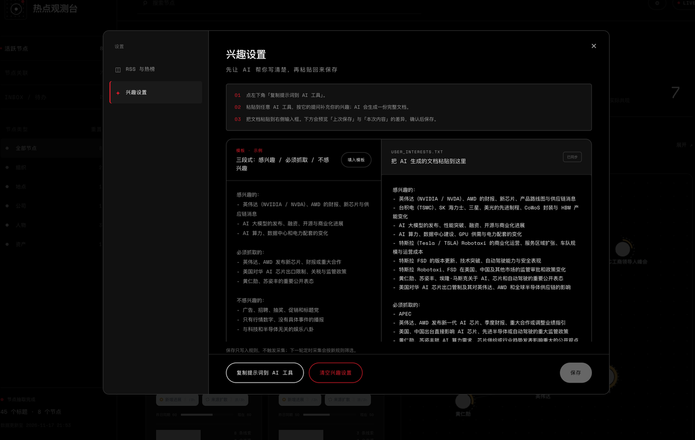
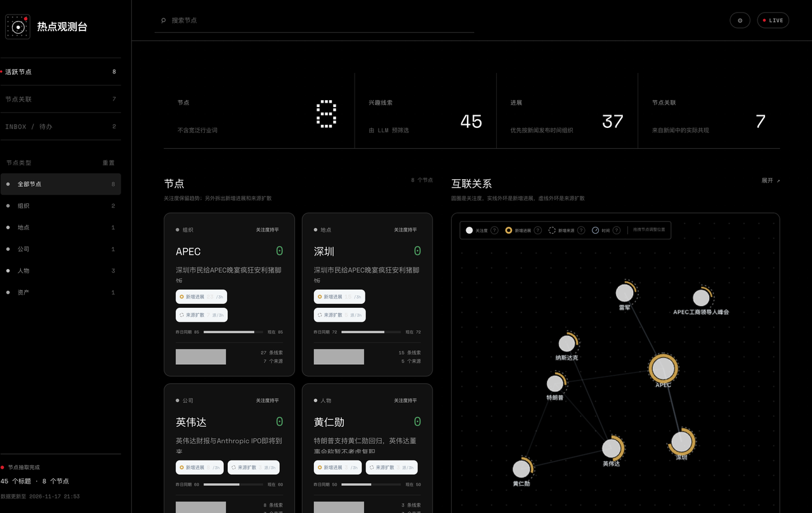
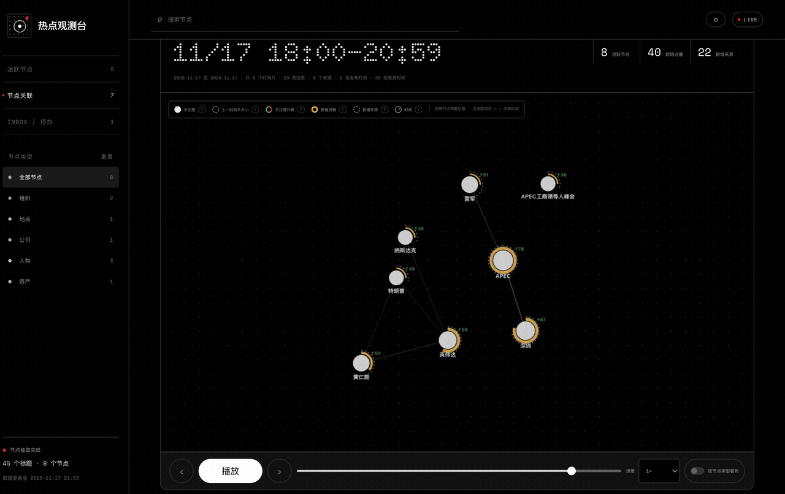
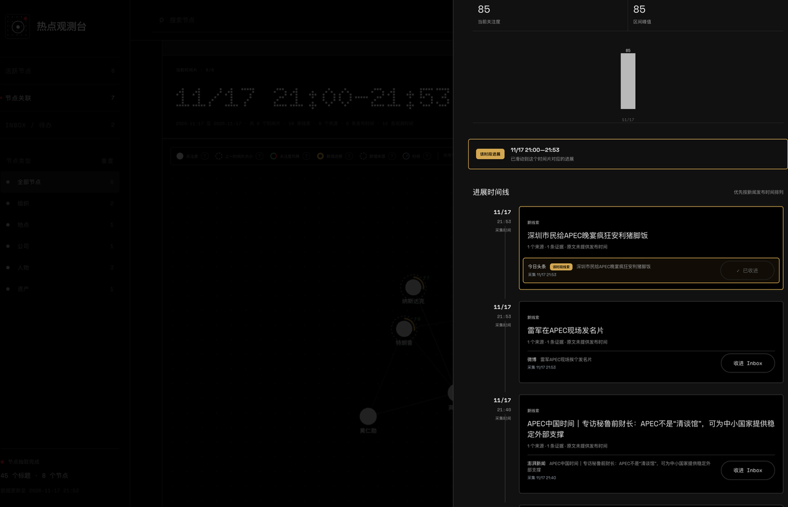

# News Signal Flow

用一张节点图抓住新闻热点的变动，看清它正在怎么变化。

News Signal Flow 按你的兴趣采集热榜和 RSS，把报道收成节点图。圆圈大小、外环和时间轴用来看关注度、新进展和来源是怎么变的。

本项目是 [TrendRadar](https://github.com/sansan0/TrendRadar) 的修改版，非官方版本。许可与修改说明见文末「来源与许可」。

## 一次使用怎么走

它按你的兴趣采集热榜和 RSS，再把报道收成一张节点图。节点是可以持续追踪的对象，比如一家公司、一个人物或一场会议。圆圈大小是过去 24 小时的关注度，黄环是当前 3 小时里的新进展，蓝环是同期新增来源。连线只表示这些节点在同一批报道里一起出现，不表示合作或因果。

下面按一次实际操作的顺序看：先设好采什么、从哪采，再看活跃节点，最后沿节点关联的时间轴点开一个节点，把一条新闻收进 Inbox。

### 1. 设置与配置

点右上角的齿轮。设置里有两页。

**兴趣设置**决定采什么。三段标题要写全：感兴趣的、必须抓取的、不感兴趣的。点「复制提示词到 AI 工具」，让模型按你的回答生成文档，再粘贴到右侧。保存前可以对照上次内容和这次内容的差异。保存只写入规则，不会马上开始采集。



**RSS 与热榜**决定从哪里采。热榜和 RSS 可以整组开关，也可以只留下其中几个来源。改完后点「保存并立即生效」，下一轮采集会按新的来源列表跑。


### 2. 活跃节点

采集完成后打开「活跃节点」。顶上是节点数、筛中的兴趣线索、进展和关联。每张卡片是一个节点，写着当前关注度、新增进展和来源扩散。



### 3. 节点关联、点开节点、收进 Inbox

「节点关联」把这些节点放在时间轴上，每 3 小时一帧。拖动时间轴，看的是同一张图在变：时间标题、新增进展和新增来源都会跟着变。下面是同一次采集里相邻的两帧，11 月 17 日 18:00–20:59，接着是 21:00–21:53。



停在某一帧，点开其中一个节点，就能看到这个节点里的新闻，以及它们怎么接成一条进展时间线。这里点的是 APEC。



要稍后读的，在那条新闻上点「收进 Inbox」。Inbox 保存标题、进展摘要、来源和原文链接，并分成待办和已完成。下面这段连着上面的时间轴：在节点关联里点开 APEC，把「雷军APEC现场挨个发名片」收进去，再打开 Inbox，它出现在待办的第一条。


## 部署

可部署在自己的服务器，也可以直接在本地运行。模型 API 需要单独配置；AI 兴趣筛选和新闻分析会产生模型调用费用。

### 服务器部署：Docker Compose

准备一台能够访问新闻源和模型 API 的 Linux 服务器，安装 Docker 与 Docker Compose。使用自定义域名访问时，将域名解析到服务器，并开放 TCP 80、443 端口。Compose 中的 Caddy 负责 HTTPS。

下载本项目代码，进入仓库根目录后执行：

```bash
git clone https://github.com/Jimmy-Chung/news-signal-flow.git
cd news-signal-flow
cp docker/.env.full.example docker/.env.full
```

编辑 `docker/.env.full`，至少配置：

| 变量 | 说明 |
| --- | --- |
| `TREND_RADAR_DOMAIN` | 你的访问域名，例如 `news.example.com` |
| `TREND_RADAR_ADMIN_TOKEN` | 自己生成的随机管理口令，用于兴趣设置和 Inbox 等操作 |
| `AI_API_KEY` | 模型服务的 API Key |
| `AI_MODEL` | 模型名称，使用 `provider/model` 格式，例如 `deepseek/deepseek-chat` |
| `AI_API_BASE` | 可选，自定义模型 API 地址 |
| `FEISHU_WEBHOOK_URL` | 可选，飞书机器人 Webhook；不需要推送时留空 |

可用 `openssl rand -hex 32` 生成管理口令。不要使用示例文件里的占位值，也不要提交填写后的环境文件。

初始化兴趣文件：

```bash
bash scripts/initialize-user-config.sh
```

编辑 `config/custom/ai/user_interests.txt`，写入自己的兴趣，格式见下方“设置关注内容”。需要关键词回退时，同时编辑 `config/custom/keyword/user_must_notify.txt`。

构建并启动：

```bash
docker compose --env-file docker/.env.full -f docker/docker-compose.full.yml up -d --build
```

服务启动后，执行首次采集和分析：

```bash
docker compose --env-file docker/.env.full -f docker/docker-compose.full.yml exec trendradar-full /app/scripts/run-trendradar.sh
```

打开 `https://你的域名`。页面在兴趣规则和模型凭据都就绪、但还没有观测快照时，也可以点「开始采集与分析」。首次采集、兴趣筛选和图谱分析需要时间，完成后刷新页面即可看到结果。没有匹配新闻时，页面可能仍没有可展示的节点。

默认每 30 分钟采集一次。采集成功后自动更新图谱；配置了通知渠道时，也可能发送消息。调度频率可通过 `CRON_SCHEDULE` 调整。环境变量修改后，重新执行启动命令以更新容器。

常用管理命令：

```bash
# 查看运行日志
docker compose --env-file docker/.env.full -f docker/docker-compose.full.yml logs -f --tail=100 trendradar-full

# 停止服务
docker compose --env-file docker/.env.full -f docker/docker-compose.full.yml down
```

### 本地运行：macOS / Linux

需要 Python 3.12+、uv、Node.js 22.13+ 和 npm。以下命令在 Bash 或 Zsh 中执行，从仓库根目录开始。

安装 Python 依赖并创建本地兴趣文件：

```bash
uv sync --locked
bash scripts/initialize-user-config.sh
```

编辑 `config/custom/ai/user_interests.txt`，然后在当前终端配置运行目录和模型。将示例值替换为自己的配置：

```bash
export TREND_RADAR_PROJECT_DIR="$PWD"
export TREND_RADAR_CONFIG_DIR="$PWD/config"
export TREND_RADAR_DATA_DIR="$PWD/output"
export TREND_RADAR_DEPLOY_MODE=direct
export TREND_RADAR_ADMIN_TOKEN="$(openssl rand -hex 32)"

export AI_API_KEY="填写你的 API Key"
export AI_MODEL="deepseek/deepseek-chat"
# 使用自定义模型地址时再设置：
# export AI_API_BASE="https://你的模型服务地址"
```

检查配置并执行首次采集：

```bash
bash scripts/run-trendradar.sh --doctor
bash scripts/run-trendradar.sh --show-schedule
bash scripts/run-trendradar.sh
```

在同一个终端中构建并启动 Web：

```bash
cd web
npm ci
npm run build
npm run preview:local
```

打开 [http://localhost:3002](http://localhost:3002)。上述方式直接使用项目的 `config/` 和 `output/`，不需要额外的 macOS 运行副本。

本地启动命令不会自动创建定时采集任务。可以在仓库根目录再次执行 `bash scripts/run-trendradar.sh`，或自行接入 cron / 系统任务；关闭 Web 不会删除已采集的数据。

macOS 现有用户也可以继续使用钥匙串与 `scripts/run-trendradar-local.sh`，以及原有的运行副本和后台任务。环境变量优先于钥匙串配置。

## 怎么使用

### 1. 设置关注内容

打开右上角设置里的「兴趣设置」，描述想增加、删除或调整的内容，生成草案并检查差异，再保存应用。也可以直接编辑 `config/custom/ai/user_interests.txt`。三段标题需要和下面一致：

```text
感兴趣的：
- 开源工具的重大更新，以及开发者实际使用这些工具的案例
- 新技术从研究走向产品的具体进展

必须抓取的：
- 我关注的产品有新版本发布或价格调整

不感兴趣的：
- 广告、招聘和没有新增信息的重复评论
```

「必须抓取的」和「不感兴趣的」是给模型的筛选要求，模型判断可能有误。旧版三段标题（必须提醒 / 感兴趣 / 明确不要）仍然可用。当前一次采集选择 AI 或关键词一种筛选方式；关键词规则在 AI 筛选失败时作为回退。Web 图谱读取 AI 筛选结果，使用图谱请保留 `config/config.yaml` 中的 AI 筛选模式。

保存规则只写入 `config/custom/ai/user_interests.txt` 并做配置校验，不会立刻采集，下一轮采集时生效。兴趣变更较小时做增量更新：新增标签会让此前未命中的新闻再筛一遍。改动达到阈值（默认 0.6）时全量重分类。当前配置 `forward_only_updates: false`，全量重分类会按新规则重新判定已有新闻。

### 2. 看节点、进展与传播

在「活跃节点」中搜索公司、产品、人物或具体进展，按类型筛选。打开节点详情，可以查看关注度走势、新闻进展和对应的原始报道。

在「节点关联」中选择日期范围，播放、暂停或拖动时间轴。观察三个不同的问题：

- **关注度**：近期整体关注程度是在增强还是减弱？
- **新进展**：报道中是否出现了新的具体变化？
- **新增来源**：是否有更多来源开始关注这个节点？

页面在打开或刷新时读取最新结果，不会自动轮询。新一轮采集完成后，刷新浏览器即可查看。

### 3. 保存与阅读

在节点详情的新闻列表中点击“收进 Inbox”，保存新闻标题、进展摘要、来源和原文链接。在 Inbox 中可以打开原文、标记完成、恢复待办或移除记录。

Inbox 保存的是阅读清单，不是网页全文归档；原文仍通过链接访问。相同新闻链接会去重。

通过公网访问时，先在“兴趣设置”输入管理口令，当前浏览器会话中的 Inbox 操作也会使用该口令。本地直接访问默认免口令。图谱本身可公开浏览，个人部署需要限制阅读权限时，请在公网入口额外配置访问控制。

### 4. 调整采集范围和推送

| 想调整的内容 | 配置位置 |
| --- | --- |
| 热榜平台、RSS 订阅 | 页面设置中的「RSS 与热榜」，或 `config/config.yaml` 与 `config/custom/rss_platforms.yaml` |
| AI 筛选阈值 | `config/config.yaml` |
| 自然语言兴趣 | 页面设置中的「兴趣设置」，或 `config/custom/ai/user_interests.txt` |
| 关键词与排除词回退规则 | `config/custom/keyword/user_must_notify.txt` |
| 不同时段的采集、增量推送和汇总策略 | `config/timeline.yaml` |
| Docker 的执行频率、模型密钥、通知凭证 | `docker/.env.full` |

通知渠道是可选的。服务器使用环境变量配置，本地 macOS 也支持钥匙串。关闭 Web 不影响已经配置好的独立采集任务和推送。

## 数据保存在哪里

Docker 部署和上面的本地直接运行方式默认使用仓库中的两个目录：

- `config/`：采集配置与个人兴趣规则。
- `output/`：新闻和 RSS 的 SQLite 数据库、图谱分析结果与缓存、HTML 报告，以及 Inbox 清单。

迁移或备份时保留这两个目录，凭证另外安全保存。图谱默认整理最近 9 天的数据；它的展示范围不等于数据库保存范围。使用自定义目录时，备份实际配置的路径。

AI 兴趣筛选和图谱分析会将新闻标题及相关上下文发送给你配置的模型服务，其中兴趣筛选包含你的偏好描述。密钥、个人规则、数据库、缓存与 Inbox 不应提交到公开仓库。

## 关于数据与来源

新闻进展由模型根据标题归纳，可能存在遗漏、误合并或误判，请通过原文核对。热榜通常没有可靠发布时间，系统会回退到首次采集时间，并在详情中标记。因此时间回放展示的是采集范围内可观察到的变化。

热榜数据依赖上游接入的 [newsnow](https://github.com/ourongxing/newsnow) 服务，RSS 来自配置的订阅源。

## 来源与许可

本项目是 [TrendRadar](https://github.com/sansan0/TrendRadar) 的**修改版，非官方版本**。

| | |
| --- | --- |
| 上游项目 | [sansan0/TrendRadar](https://github.com/sansan0/TrendRadar) |
| 基线版本 | v6.10.0 |
| 修改日期 | 2026-11-17 |
| 许可 | GPL-3.0，见 [LICENSE](LICENSE) |

在上游基础上做出的修改：

- 保留上游的热榜/RSS 采集、AI 兴趣筛选、通知与报告能力，内核 `trendradar/`、`mcp_server/` 大部分保持原样；
- 新增 `web/` 节点观测界面（Next.js）：节点列表、节点图谱、三小时时间片回放、Inbox；
- 新增 `web/scripts/export_entity_data.py` 等脚本，把兴趣筛选结果整理成节点快照；
- 新增 `docker/Dockerfile.full`、`docker/entrypoint-full.sh` 与 `scripts/` 下的本地部署脚本；
- 调整运行时路径解析、新增 `config/custom/rss_platforms.yaml` 配置覆盖、把 MCP 默认监听地址改为仅本机；
- 重写本 README，上游原中文说明保留在 [README.upstream.md](README.upstream.md)，其中的界面、部署方式和功能说明以原项目为准。

本项目的修改部分与上游代码一起，整体按 **GPL-3.0** 发布。（GPL-3.0 第 5(a) 条要求分发修改版时显著声明修改并注明日期，本段即为此声明。）
